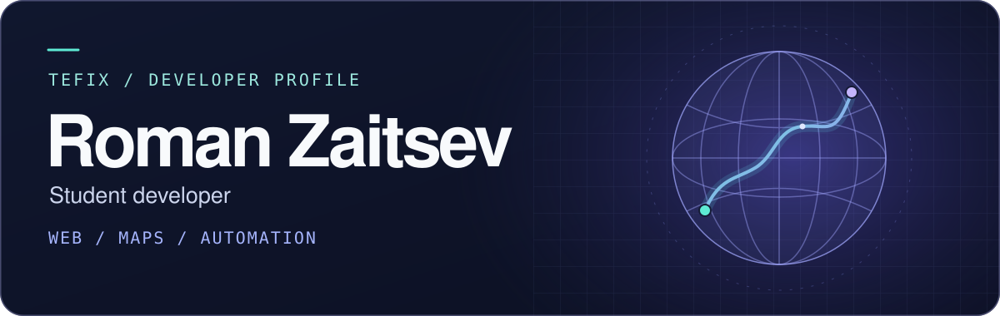

# Hi, I'm Roman 👋

I'm Roman Zaitsev, a student developer who enjoys building web projects and writing scripts to automate everyday tasks. I use this profile to share what I'm building as I learn.

[Browse my repositories →](https://github.com/Tefix?tab=repositories)

## 🗺️ Featured project

### [GoogleMapsKML](https://github.com/Tefix/GoogleMapsKML)

One KML file, three ways to explore it. The project uses Leaflet and OpenLayers to show the same markers, route, and area on 2D maps. The Cesium branch adds a 3D globe with controls to inspect features, toggle the route, and reset the view.

[Explore the Cesium branch →](https://github.com/Tefix/GoogleMapsKML/tree/feature/cesium-kml)

## 🧰 Toolbox

| | Technologies |
| :--- | :--- |
| **I build with** | `Python` · `PHP` · `HTML` · `CSS` |
| **I work with** | `Git` · `GitHub` · `Docker` · `Linux` · `VS Code` |
| **I'm learning** | `JavaScript` · `SQL` |

## 🌱 What I'm working on

- Building interactive web maps and experimenting with geographic data.
- Practicing automation and getting more comfortable with containers.
- Learning how to organize work with Git branches and LiteTracker.

---

*Dream big ☁️*
